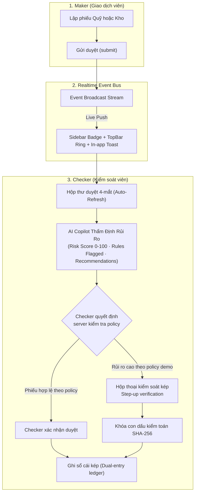

# Kho Trà Sữa — Hệ Thống Vận Hành Tồn Kho & Quỹ Mô Phỏng

[](https://github.com/imtarget05/QuanLyKho/actions/workflows/ci.yml)
[](https://flutter.dev)
[](https://fastapi.tiangolo.com)
[](https://postgresql.org)
[](https://developers.cloudflare.com)
[](https://github.com/imtarget05/QuanLyKho)

> **Product boundary:** Đây là ứng dụng vận hành **kho nguyên liệu trà sữa**. Các module quỹ, journal và đối soát chỉ là **financial-operations simulation** để minh hoạ maker-checker, audit và tính đúng đắn giao dịch. Đây không phải core-banking, không kết nối ngân hàng, không sử dụng dữ liệu khách hàng thật và không xử lý tiền thật.

> **Thiết kế web/app nhân viên — khảo sát 14/10/2026:** Xem [bộ tài liệu hiện trạng, kiến trúc, luồng nghiệp vụ và backlog nghiệm thu](docs/employee-app/README.md). Tài liệu phân biệt phần đã có trong mã nguồn với phần đề xuất, đồng thời ghi nhận các khác biệt FastAPI/Worker và các vấn đề cần xử lý trước pilot. Các số liệu kiểm thử bên dưới là kết quả lịch sử, chưa chứng nhận working tree hiện tại.

> **Nguồn API chuẩn:** FastAPI + PostgreSQL là backend nghiệp vụ duy nhất. Thư mục Cloudflare Worker được giữ tạm để tương thích/đối chiếu, không có cam kết parity và không phải đích deploy production. Chi tiết ở [kiến trúc](docs/03-architecture.md) và [ghi chú Cloudflare](docs/14-cloudflare-deploy.md).

---

## 1. Điểm Nhấn Kiến Trúc Nâng Cấp (Key Architectural Pillars)



### 1.1. Real-time Dual-Control Notification & Live Sync
- **Đồng bộ sự kiện thời gian thực:** Ngay khi Maker gửi phiếu, Checker nhận thông báo Toast nổi, badge `X CHỜ DUYỆT` trên thanh điều hướng tự động nhảy số.
- **Hộp thư duyệt tự động làm mới:** Tự động reload danh sách phiếu chờ duyệt mà không cần người dùng thao tác F5.

### 1.2. Smart Maker-Checker AI Copilot & Risk Scoring
- **Phân tích rủi ro đa chiều:** Tính toán `risk_score` (0-100), phân loại `LOW` / `MEDIUM` / `HIGH`.
- **Nhận diện vi phạm định mức:** Phát hiện tự động các lệnh rút tiền vượt định mức quầy ($\ge 500$ triệu VND) hoặc xuất ấn chỉ/phôi thẻ số lượng lớn ($\ge 50$ phôi).
- **Kiến nghị hành động & Con dấu kiểm toán:** Đề xuất kiểm đếm thực tế, đối chiếu chứng từ và sinh mã Audit Stamp Hash SHA-256:
  $$\text{Audit Stamp} = \text{SHA256}(\text{request\_id} : \text{maker} : \text{amount} : \text{risk\_score})$$

### 1.3. Dual-Control Security Verification
- **Cơ chế 4 mắt bắt buộc:** Với các lệnh mô phỏng rủi ro cao, hệ thống yêu cầu step-up verification tại Client và Server. Giá trị demo chỉ được seed trong demo profile, không phải credential triển khai.
- **Kiểm soát dòng tiền chặt chẽ:** Tự động từ chối nếu số dư két không đủ (`INSUFFICIENT_SIM_CASH`) trước khi cấp quyền ghi sổ.

---

## 2. Hệ Thống Trợ Lý AI & Small LLM Pipeline

1. **Trợ lý Hội thoại Kho-Trà-Sữa AI (qua FastAPI)**:
   - FastAPI là lớp duy nhất áp dụng RBAC, retrieval và guardrail trước khi gọi provider AI.
   - Cloudflare Workers AI có thể là provider từ xa khi FastAPI được cấu hình phù hợp; Worker trong repository không phục vụ API chat production.
2. **Small LLM Pipeline Cho Máy Không Có GPU & Google Colab T4**:
   - Mô hình nền tảng: `Qwen2.5-1.5B-Instruct` (GGUF Quantized 4-bit `q4_k_m`, tiêu thụ < 1.4 GB RAM trên CPU).
   - Notebook huấn luyện mẫu: [`ai/colab_finetune_kho-tra-sua_t4.ipynb`](ai/colab_finetune_kho-tra-sua_t4.ipynb). Thời gian huấn luyện phụ thuộc máy và chưa là SLA.
   - Tập dữ liệu huấn luyện: [`ai/dataset/train.jsonl`](ai/dataset/train.jsonl); đây là dữ liệu demo, không phải dữ liệu giao dịch thật.
   - Máy chủ suy luận CPU độc lập: [`ai/serve_cpu.py`](ai/serve_cpu.py) tương thích OpenAI API và Ollama.

---

## 3. Demo profile và phân quyền

Demo profile chỉ phục vụ local/interview. Không công bố credential trong README, không seed tài khoản demo ngoài `APP_ENV=demo` và không dùng demo auth/Google mock trong pilot hoặc production.

| Username | Vai trò (Role) | Quyền hạn chính |
| :--- | :--- | :--- |
| **`demo_maker`** | Maker (Giao dịch viên) | Tạo & gửi duyệt phiếu thu/chi quỹ, xuất/nhập kho, import dữ liệu Staging. Tab "Duyệt" bị ẩn hoàn toàn để bảo đảm nguyên tắc kiểm soát kép. |
| **`demo_checker`** | Checker (Kiểm soát viên) | Hộp thư phê duyệt 4-mắt, xem phân tích AI Copilot, duyệt/từ chối phiếu (kèm xác thực PIN với lệnh rủi ro cao), chạy đối soát số liệu. |
| **`demo_auditor`** | Auditor (Kiểm toán nội bộ) | Xem báo cáo tài chính, biến động dòng tiền, lịch sử nhật ký kiểm toán và chuỗi hàm băm toàn vẹn dữ liệu. |

> Google/demo auth chỉ được bật trong demo profile. Pilot/production cần IdP được phê duyệt và quyền được cấp qua quy trình provisioning.

---

## 4. Khởi Chạy Nhanh Hệ Thống (Docker Compose)

Khởi động toàn bộ cụm dịch vụ (Web UI + FastAPI + Worker + PostgreSQL 16) chỉ với 1 câu lệnh:

```bash
docker compose up -d --build
```

- **Giao diện Web App (Nginx Flutter Web):** [http://localhost:8080](http://localhost:8080)
- **Tài liệu Backend Swagger UI:** [http://localhost:8000/docs](http://localhost:8000/docs)
- **API Health Check:** [http://localhost:8000/health/live](http://localhost:8000/health/live)
- **Cơ sở dữ liệu PostgreSQL:** local development only; cấu hình kết nối nằm trong file env bị ignore, không dùng credential README cho môi trường pilot/production.

---

## 5. Kiểm Thử Chất Lượng & Nghiệm Thu Tự Động

### 5.1. Chạy Kịch Bản Kiểm Chứng E2E Maker-Checker Thực Tế
Chạy script kiểm tra trực tiếp trên cụm Docker API và PostgreSQL thật:
```bash
python3 backend/tests/verify_live_e2e.py
```
> Đây là kịch bản demo mô phỏng. Chỉ coi kết quả là bằng chứng khi chạy trên commit hiện tại, với database test cô lập; không suy diễn thành chứng nhận triển khai production.

### 5.2. Chạy Toàn Bộ Test Suite Backend & Frontend (1-Click)
```bash
# Kiểm tra toàn bộ linter, typecheck và tests của cả Backend + Frontend + Worker legacy
make check-all

# Hoặc chạy từng phân hệ thủ công:
# 1. Kiểm tra tĩnh & linter (Worker typecheck không chứng minh parity API)
python3 -m ruff check backend/ ai/
cd frontend && flutter analyze .
cd infra/cloudflare-worker && npm run typecheck

# 2. Chạy unit & widget tests Frontend (28/28 passed)
cd frontend && flutter test --no-pub

# 3. Chạy unit & integration tests Backend trên PostgreSQL tạm.
# Không trỏ pytest vào database demo/dev đang chạy ở cổng 5432.
make test-backend
```

---

## 6. Cấu Trúc Thư Mục Dự Án

```
Kho-Trà-Sữa/
├── ai/                          # Small LLM Pipeline (Qwen2.5-1.5B, Colab Notebook, Dataset)
├── backend/                     # FastAPI Backend (Clean Architecture, Async SQLAlchemy)
│   ├── app/api/routes/          # API Routers (auth, cash_sim, inventory, approvals, ai, reports)
│   ├── app/services/            # AI services, ledger, approval controls, SSE approval events
│   └── tests/                   # Test suite (136 tests: E2E, QA acceptance, contracts, AI, SSE)
├── frontend/                    # Flutter Web Client (Material 3, Responsive Desktop/Mobile)
│   ├── lib/src/features/        # Các phân hệ (auth, approvals, cash, inventory, reports, ai, timeline)
│   └── test/                    # Widget & Unit test suite (28 tests: roles, exports, timeline, charts)
├── infra/cloudflare-worker/     # Implementation legacy/compatibility; không phải API production
├── infra/hf-llm-space/          # Self-hosted llama.cpp Docker Space cho Hugging Face
├── sample-data/                 # Dữ liệu mẫu ban đầu (users, cashboxes, items, locations)
└── docker-compose.yml           # Cấu hình cụm Docker 4 containers
```

---

## 7. Phạm vi pilot thay bằng ứng dụng kho trà sữa (10/2026)

> **Domain hiện tại:** Nhập–Xuất–Tồn nguyên liệu theo 3 ca (Sáng 07:30–15:00,
> Chiều 15:00–23:00, Lỡ ngày 07:30–18:00), theo `docs/SRS_QUAN_LY_KHO_TRA_SUA.md`.
> Module Quỹ/Tích hợp/Đối soát là simulation financial-operations phụ trợ; không
> là core-banking và không là product boundary chính.
>
> Năng lực cần được xác minh trên exact commit: danh mục nguyên liệu + Min/Max,
> phiếu nhập (lô/HSD), chốt ca, điều chỉnh, cảnh báo tồn thấp/cận date và báo cáo.
> AI assistant là tính năng hỗ trợ, không thay thế kiểm soát nghiệp vụ.

> **Kiểm chứng phỏng vấn:** [audit nghiệp vụ, ma trận bằng chứng và demo AI → checker](docs/PORTFOLIO_AUDIT_2026-10-21.md). AI assessment nhận dữ liệu do client gửi, nên đánh giá chỉ là tư vấn; quyết định ghi tồn kho luôn đi qua phiếu canonical, RBAC và giao dịch FastAPI.
>
> Chưa triển khai (cần consent của TEAM): offline chốt ca + outbox đồng bộ (Phase 6),
> FCM/push real, tích hợp Google Sheets/APPs Script, deploy staging + UAT luồng ca.

(Trivial smoke-test commit to trigger `ci.yml` CI on push to main.)

