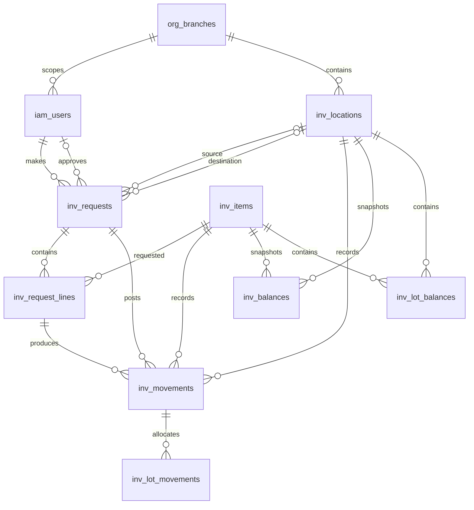

# 04 — PostgreSQL schema, ledger, migration

## Quy ước

UUID PK, `created_at/updated_at timestamptz` UTC, `version int` optimistic locking, `numeric(20,2)` cho tiền mô phỏng, `numeric(20,3)` cho số lượng; không dùng float. Tất cả FK `NOT NULL` khi nghiệp vụ yêu cầu. Delete mềm cho danh mục; transaction/ledger/audit không delete. Tên bảng có tiền tố module.

## Bảng tối thiểu

| Bảng | Trường và ràng buộc chính |
|---|---|
| `iam_users` | id, username unique, password_hash, status, display_name_demo |
| `iam_roles`, `iam_user_roles` | role code unique, user/role unique |
| `inv_locations` | id, code unique, name, active |
| `inv_items` | id, sku unique, name, unit, tracked_serial boolean, active |
| `inv_assets` | id, item_id, serial unique, location_id, assignee_demo, status |
| `inv_requests` | id, kind(receipt/issue/transfer/adjustment), status, maker_id, approver_id nullable, source/dest, version, submitted_at |
| `inv_request_lines` | request_id, item_id, quantity > 0, serial nullable; unique per request/item/serial as needed |
| `inv_movements` | id, request_id, line_id, item_id, location_id, quantity_signed, posted_at; unique(request_id,line_id,location_id) |
| `inv_balances` | location_id, item_id PK, quantity >= 0, version; derived cache updated transactionally |
| `cash_boxes` | id, code unique, name, currency='VND', active |
| `cash_requests` | id, cashbox_id, kind(receipt/payment/adjustment), amount > 0, status, maker_id, approver_id, version, reason |
| `cash_journals` | id, request_id unique, posted_at, reversal_of nullable unique, correlation_id |
| `cash_entries` | id, journal_id, account_code, debit >= 0, credit >= 0, check exactly one positive; sum debit=credit enforced in posting service/constraint trigger |
| `cash_balances` | cashbox_id PK, amount >= 0, version; derived cache updated transactionally |
| `approval_decisions` | id, subject_type, subject_id, actor_id, decision, reason, created_at; unique final decision per subject |
| `audit_events` | id, actor_id, action, subject, before_hash, after_hash, request_id, occurred_at, metadata_json; append-only |
| `outbox_events` | id, event_type, aggregate_id, payload_json, created_at, published_at nullable, attempts |
| `jobs` | id, type, status, processed, total nullable, error_code nullable, owner_id, created/updated_at |
| `integration_connections` | id, type, name, secret_ref, status, owner_id; no plaintext token |
| `integration_runs`, `integration_staging_rows` | run id, source fingerprint, mapping version, validation status, raw demo payload, unique(run_id, source_row_key) |
| `activity_events` | id, owner_id/role, type, subject, message_key, payload, occurred_at; unique(outbox_event_id) |
| `reconciliation_runs`, `reconciliation_exceptions` | scope, expected, actual, status, resolved_by, resolution_note |

## Ledger quỹ mô phỏng

Accounts MVP: `SIM_CASH:{cashbox_id}` và `SIM_OFFSET:DEMO`. Receipt: debit cash, credit offset. Payment: debit offset, credit cash. Cả hai cùng amount; `SUM(debit-credit)=0`. Balance cashbox là tổng debit-credit của `SIM_CASH`. Trước payment, lock `cash_balances` row và kiểm tra đủ tiền trong cùng transaction. Reversal là journal mới đảo chiều, liên kết original, cần phê duyệt riêng; không sửa entry cũ.

## Movement kho

Receipt: +qty tại đích. Issue: -qty tại nguồn. Transfer: hai movement -qty/+qty trong một transaction. Lock balance theo thứ tự khóa ổn định để tránh deadlock. `inv_balances` khớp tổng movements; reconciliation tính lại và ghi exception nếu lệch. Adjustment chỉ qua request/approval, nêu lý do.

## ERD luồng tồn kho

Sơ đồ tập trung vào luồng nhập/xuất; một số quan hệ audit/outbox là tham chiếu logic
qua `subject`/`aggregate_id`, không phải foreign key:

`inv_balances` dùng khóa chính kép `(location_id, item_id)`; `inv_movements`
có unique constraint `(request_id, line_id, location_id)` để chặn ghi trùng
movement cùng dòng tại cùng kho. `audit_events` và `outbox_events` được ghi
cùng transaction với trạng thái phiếu, movement và ledger; audit là append-only.

## Index và ràng buộc truy vấn

Các index/constraint dưới đây phản ánh SQLAlchemy model và migration hiện tại:

- PK `inv_balances(location_id, item_id)` phục vụ lookup tồn theo kho + mặt hàng.
- `uq_movement_request_line_location` bảo vệ tính duy nhất movement theo phiếu,
  dòng và kho.
- `inv_lot_balances` có index trên `location_id`, `item_id`, `expiry_date` và
  unique expression index trên `(location_id, item_id, coalesce(lot_no, ''),
  coalesce(expiry_date, '2099-12-31'))`; hỗ trợ lookup lô/FEFO và vẫn duy nhất
  với dữ liệu lot cũ có giá trị NULL.
- `inv_lot_movements` có index trên `movement_id`, `request_id`, `lot_no` và
  `expiry_date` để tra cứu lịch sử phân bổ lô.
- `iam_scope_grants(user_id, branch_id)` hỗ trợ kiểm tra phạm vi người dùng.
- `inv_request_lines.quantity > 0` và `direction IN ('increase', 'decrease')`
  giữ bất biến số lượng ở tầng DB.

Chưa có báo cáo `EXPLAIN (ANALYZE, BUFFERS)` trên dữ liệu đại diện; danh sách
index là mô tả schema, không phải claim benchmark. Đặc biệt, endpoint audit sắp
xếp keyset theo `(occurred_at DESC, id ASC)` nhưng model hiện chưa khai báo
composite index riêng cho thứ tự này; cần đo trước khi bổ sung index.

## Migration strategy

Alembic revision tuần tự; expand → backfill có kiểm tra → switch app → contract sau. Không đổi/xóa cột trong cùng deploy với code cũ. Migration có upgrade/downgrade khi hợp lý; ledger/audit không rollback bằng xóa dữ liệu. Seed demo là lệnh riêng idempotent và bị chặn ở production. Test migrate từ DB trống và phiên bản trước; backup/restore trước deploy.
