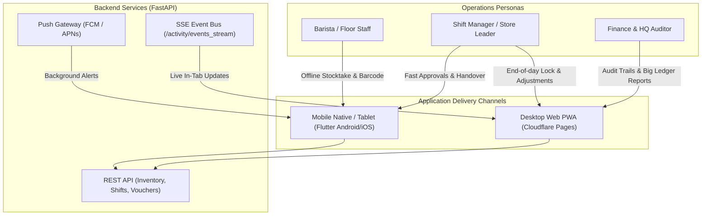

# QuanLyKho Device Channel Strategy & Persona Mapping

## 1. Executive Summary
This document defines the production channel allocation for QuanLyKho, matching user personas in milk tea operations with target runtime devices, network resilience requirements, and delivery mechanisms.

---

## 2. Persona & Channel Matrix

---

## 3. Offline & Sync Resilience Specification
- **Storage:** Offline entries are stored in encrypted client storage using `StocktakeOutbox`.
- **Auto-flush:** On network restoration (`connectivity_plus`), `offline_ui.dart` triggers `tryFlush()`.
- **Conflict Prevention:** If a shift was already locked by another manager, the server returns `409 Conflict`, prompting the user to view the server's locked snapshot instead of overwriting.

---

## 4. Push Notification Architecture
- **Registration:** Clients register their device token upon login via `POST /api/v1/notifications/devices/register`.
- **De-registration:** Clean logout calls `DELETE /api/v1/notifications/devices/{token}`.
- **Provider Gateway:** In production, FCM v1 HTTP API is used. In automated tests and staging without FCM secrets, the system seamlessly uses the verified simulated provider (`fcm-simulated`).
