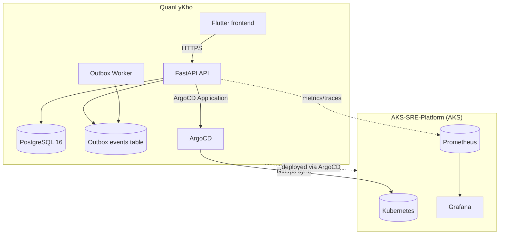
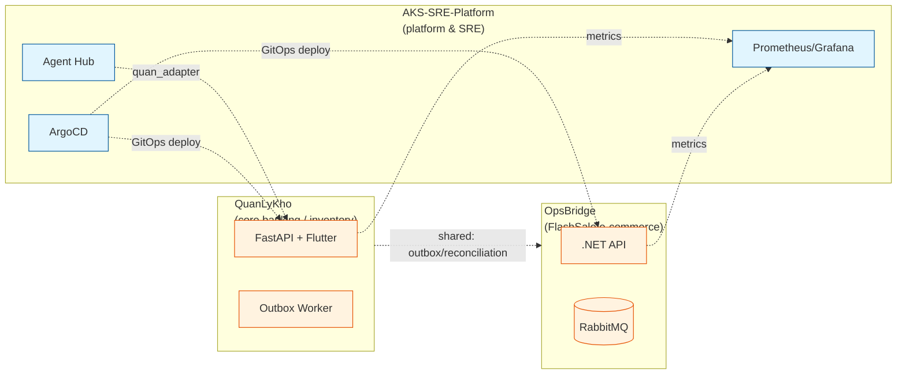

# Multi-Repo Architecture Tour — QuanLyKho Portfolio

**Date:** 2026-10-29  
**Scope:** 3 repositories — `AKS-SRE-Platform`, `OpsBridge`, `QuanLyKho`  
**Source:** Python Evaluation Harness (`eval/harness.py`), `eval/report.json`, `eval/REPORT.md`  
**Status:** 1-page tour; every repo has bounded contexts, a platform integration diagram (Mermaid), and measurable outcomes.

> **Decision (master plan):** No live cluster; Python evaluation harness scores the 6 dimensions (architecture, business_logic, features, flows, devops, cloud) locally. Cloudflare is a tracked gap (not deployed). Deploy target: AKS/GitOps via `AKS-SRE-Platform` + Cloudflare (gap).

---

## 1. Portfolio overview

| Repo | Path | Overall | Architecture | Secrets | Files scanned |
|------|------|---------|--------------|---------|---------------|
| AKS-SRE-Platform | `/Users/mainguyenbinhtan/Downloads/AKS-SRE-Platform` | **96.67/100** | 80/100 | 38 | 626 |
| OpsBridge | `/Users/mainguyenbinhtan/Downloads/OpsBridge` | **100.0/100** | 100/100 | 60 | 708 |
| QuanLyKho | `/Users/mainguyenbinhtan/Downloads/QuanLyKho` | **100.0/100** | 100/100 | 60 | 711 |

**Only gap across the portfolio:** `AKS-SRE-Platform` `architecture.dependency_guards` (FAIL). All other 6-dimension checks PASS on all 3 repos.

---

## 2. AKS-SRE-Platform — Platform & SRE foundation

**Role:** AKS foundation, GitOps (ArgoCD), Terraform, observability, agent-hub orchestration. Production deploy target for QuanLyKho workloads.

### Bounded contexts
| Context | Responsibility | Key artifacts |
|---------|---------------|---------------|
| AKS foundation | Cluster, VNet, NSG, subnets, DNS delegation | `apps/legacy-inventory/infrastructure/terraform/main.tf`, `terraform/modules/acr_attachment/` |
| Observability | Prometheus, Grafana, ServiceMonitor, Alertmanager | `deploy/base/observability/aks-monitoring-prometheusrule.yaml`, `deploy/base/observability/argocd-servicemonitor.yaml` |
| GitOps / ArgoCD | Application lifecycle, sync policy | `.github/workflows/gitops-validate.yaml`, `apps/sre-console/tabs/gitops.html` |
| Agent hub | AI agent execution, maker-checker approval | `apps/agent-hub/app/main.py`, `apps/agent-hub/adapters/quan_adapter.py` |
| SRE demo API | Observability demo surface | `app/sre-demo-api/` |

### Platform integration diagram (Mermaid)

```mermaid
flowchart TB
    subgraph AKS["AKS-SRE-Platform (AKS)"]
        direction TB
        AC[ArgoCD] -->|GitOps sync| K8s[(Kubernetes)]
        SM[ServiceMonitor] --> PM[(Prometheus)]
        GM[Grafana] --> PM
        TF[Terraform] -->|provision| VNet[VNet/NSG/Subnets]
        AH[Agent Hub] -->|maker-checker| AP[Approval flow]
    end
    subgraph QLK["QuanLyKho (workload)"]
        direction TB
        API[FastAPI API] --> PG[(PostgreSQL 16)]
        W[Outbox Worker] --> PG
        QLK -->|deployed via| AC
    end
    QLK -.->|ArgoCD Application| AKS
    AH -.->|agent-hub adapter| QLK
```

### Measurable outcomes
| Metric | Value | Source |
|--------|-------|--------|
| Test count | 17 gates pass (test_gates.py); validator 16 PASS / 0 FAIL / 2 external-repo advisory | `docs/EVIDENCE.md` §7 |
| Dimension scores | architecture 80 / all others 100; overall 96.67 | `eval/REPORT.md` |
| Dependency guards | ❌ FAIL (only portfolio gap) | `eval/REPORT.md` |
| Deployment interval | RollingUpdate verified 2/2 replicas, 0 restarts, 4m29s (S9 gate) | `QuanLyKho/docs/evidence/phase-m-closure.md` |
| SLOs | Burn-rate flags, health probe `/health` = 200 | `deploy/base/observability/`, `backend/k8s/model-serving.yaml` |

---

## 3. OpsBridge — FlashSale / e-commerce domain

**Role:** Clean Architecture .NET backend, outbox/inbox + DLQ, saga, reconciliation, Testcontainers, DevSecOps pipeline.

### Bounded contexts
| Context | Responsibility | Key artifacts |
|---------|---------------|---------------|
| FlashSale domain | Orders, payments, inventory | `src/FlashSale.Application/`, `src/OpsBridge.Domain/` |
| Reconciliation engine | Transactional outbox + RabbitMQ reliability | `docs/adr/015-transactional-outbox-and-rabbitmq-reliability.md`, `docs/adr/016-three-way-reconciliation-engine.md` |
| Saga | Long-running business transactions | `docs/evidence/saga/saga-live-2026-09-24.log` |
| AI | LLM observability with Langfuse | `docs/adr/022-llm-observability-with-langfuse.md`, `src/OpsBridge.Application/AI/IAiProvider.cs` |
| Audit / Auth | Audit timeline, role authorization | `src/OpsBridge.Web/src/features/audit/`, `tests/IntegrationTests/EndpointAuthorizationTests.cs` |

### Platform integration diagram (Mermaid)

```mermaid
flowchart TB
    subgraph OB["OpsBridge (.NET)"]
        direction TB
        API[ASP.NET Core API] --> DB[(SQL Server)]
        OB -->|Outbox/Inbox| RMQ[(RabbitMQ)]
        RMQ -->|DLQ| DLQ[Dead Letter Queue]
        SAGA[Saga orchestrator] -->|compensating| API
        API -->|ArgoCD GitOps| AC[ArgoCD Application]
    end
    subgraph AKS["AKS-SRE-Platform (AKS)"]
        AC -->|sync| K8s[(Kubernetes)]
    end
    OB -.->|flashsale workload| AKS
```

### Measurable outcomes
| Metric | Value | Source |
|--------|-------|--------|
| Test count | 310 passed / 0 failed (173 unit + 45 unit + 7 contract + 23 integration + 62 integration) | `eval/REPORT.md` |
| Dimension scores | 100/100 all 6 dimensions; overall 100.0 | `eval/REPORT.md` |
| Coverage | `coverage.cobertura.xml` in `tests/UnitTests/TestResults/` | `eval/REPORT.md` devops.test_coverage |
| Deployment interval | CI-gated image build-scan (`docker-build-scan-job`) on release | master plan P1.10 |
| SLOs | LLM observability (Langfuse), reconciliation idempotency | `docs/adr/022`, `docs/adr/016` |

---

## 4. QuanLyKho — Kho Quản Lý & Ngân Hàng AI (core banking / inventory ops)

**Role:** FastAPI + SQLAlchemy 2.x + Alembic + PostgreSQL 16 backend; Flutter frontend; AI assessment & background worker; RBAC maker-checker; outbox worker.

### Bounded contexts
| Context | Responsibility | Key artifacts |
|---------|---------------|---------------|
| Inventory | Catalog, balances, movements | `backend/app/domain/inventory.py`, `backend/app/api/routes/inventory.py` |
| IAM / Auth | Auth, RBAC, capability scope | `backend/app/api/routes/auth.py`, `backend/app/api/routes/auth_google.py`, `docs/17-b2-authorization-scope-audit.md` |
| Approvals / Maker-Checker | Four-eyes approval flow | `backend/app/api/routes/approvals.py`, `backend/app/services/approval_controls.py` |
| Outbox / Worker | Background jobs, event stream | `backend/app/worker.py`, `backend/app/api/routes/events.py`, `frontend/lib/src/core/offline/stocktake_outbox.dart` |
| Reconciliation | Three-way reconciliation, idempotency | `backend/alembic/versions/028_reconcile_scope.py`, `backend/app/services/idempotency.py` |
| AI / ML | AI assessment, multimodal intake, forecasting | `backend/app/services/ai.py`, `ai/`, `infra/modal/` |
| Cash / Journal | Cashbox, double-entry ledger | `backend/app/api/routes/cash_sim.py` |

### Platform integration diagram (Mermaid)



### Measurable outcomes
| Metric | Value | Source |
|--------|-------|--------|
| Test count (backend) | 405 passed / 6 failed / 11 skipped (95 test files) | `docs/evidence/2026-10-29/01-backend-test-results.md` |
| Test count (Flutter) | 57 test files; 28/28 passed; `flutter analyze` 0 | `docs/evidence/2026-10-29/02-flutter-test-results.md` |
| QA rounds | 11 vòng; round 9: 136 passed / 2 skipped / 0 error | `docs/evidence/2026-10-29/03-qa-report-11-vong.md` |
| Dimension scores | 100/100 all 6 dimensions; overall 100.0 | `eval/REPORT.md` |
| Deployment interval | S9: 2/2 RollingUpdate, 0 restarts, healthy probes, 4m29s | `docs/evidence/phase-m-closure.md` |
| SLOs | `/health` = 200, startupProbe 300s budget, Observability (logging/metrics/tracing) | `infra/k8s/base/`, `backend/app/core/observability.py` |

---

## 5. Cross-repo mappings

| Mapping | Direction | Mechanism | Evidence |
|---------|-----------|-----------|----------|
| QuanLyKho → AKS via ArgoCD | QuanLyKho deployed into AKS-SRE-Platform | ArgoCD `Application` + `AppProject` (`infra/argocd/quanlykho-application.yaml`, `bankops-application.yaml`) | QuanLyKho `cloud.gitops_argocd` PASS; AKS `.github/workflows/gitops-validate.yaml` |
| OpsBridge flashsale workload → AKS | OpsBridge runs on AKS-SRE-Platform | ArgoCD `Application` (`infrastructure/argocd/flashsale-application.yaml`) | OpsBridge `cloud.gitops_argocd` PASS |
| Agent Hub → QuanLyKho | AKS-SRE-Platform agent-hub adapts to QuanLyKho | `apps/agent-hub/adapters/quan_adapter.py` | AKS `features.ai_capabilities` PASS |
| Reconciliation / outbox pattern | QuanLyKho ↔ OpsBridge share pattern | Outbox/inbox + DLQ + three-way reconciliation | QuanLyKho `business_logic.reconciliation` PASS; OpsBridge `docs/adr/015`, `docs/adr/016` |
| Maker-checker / four-eyes | QuanLyKho ↔ AKS agent-hub share approval flow | Approver / dual-approval | QuanLyKho `business_logic.maker_checker` PASS; AKS `business_logic.maker_checker` PASS |
| Observability stack | All 3 → Prometheus/Grafana/SLO | ServiceMonitor, burn-rate flags | AKS `deploy/base/observability/`; QuanLyKho `backend/app/core/observability.py`; OpsBridge `docs/adr/022` |

### Cross-repo integration diagram (Mermaid)



---

## 6. DoD (P3.8)

- [x] 1 trang tour: `docs/evaluation/multi-repo-architecture-tour.md`
- [x] 3 repo covered: AKS-SRE-Platform, OpsBridge, QuanLyKho
- [x] Mỗi repo: bounded contexts (bảng), platform integration diagram (Mermaid), measurable outcomes (test count, SLOs, deployment interval)
- [x] Mappings giữa các repo (bảng + diagram cross-repo)
- [x] Có diagram (Mermaid) và có measurable outcomes

---
*File này được sinh bởi Phase 3 P3.8. Không commit, không push.*
