# Journey Evidence — QuanLyKho Inventory (Nhap/Xuat Kho)

**Repo:** `QuanLyKho` · **Stack:** FastAPI + SQLAlchemy 2.x + Alembic + PostgreSQL 16 + Poetry + Pytest
**Branch/SHA tested:** `main` @ `5f0890b6c4117f634e57058da07266039b5ca5b6` (merge SHA of PR #14/#15 reconciliation)
**Data:** 100% fake/demo data (tea-shop ingredient simulation). No customer data, no bank connection, no real credentials. This is a demo portfolio, not production banking.

## What was verified

| Check | Command | Result |
|---|---|---|
| Ruff lint | `ruff check backend/` | 0 errors, exit 0 |
| Alembic fresh DB | `alembic upgrade head` (001 → 034) | Clean, exit 0 |
| Seed demo | `python -m app.seed` | Idempotent, exit 0 |
| Demo journey (2 tests) | `pytest tests/test_portfolio_ai_checker_demo.py` | 2 passed, exit 0 |
| Full backend suite | `pytest tests -q` (bankops_test) | 977 passed, 8 skipped, 1 xfailed, 0 failed, exit 0 |
| Smoke script | `bash scripts/smoke_demo.sh` | PASS, 2 passed |

Full-suite teardown logs (`Event loop is closed`, pending `send_security_alert_email` tasks) are asyncpg/gc cleanup noise at interpreter shutdown, not test failures. Exit code was 0.

## Demo journey steps (Q1)

Run on an empty test database: `empty -> migrate -> seed -> journey`.

1. **Nhap kho (receipt):** `demo_maker` creates a `receipt` request (+12 qty, lot `DEMO-LOT`), submits it. Status becomes `submitted`; no stock movement is posted yet (`GET /inventory/movements?request_id=` returns `[]`).
2. **Duyet (approve):** `demo_checker` approves. Request status -> `posted`; exactly one movement (`quantity_signed = 12`) appears. Stock balance increases by 12.
3. **RBAC negative (self-approval forbidden):** `demo_maker` attempts to approve their own submitted request → `403 SELF_APPROVAL_FORBIDDEN`. Only a different checker may approve.
4. **Tu choi (reject):** Checker rejects a second receipt → status `rejected`; no movement posted.
5. **Xuat kho (issue):** `demo_maker` creates an `issue`/`sale` request (-5 qty), checker approves → balance decreases by 5 (net before +12 -5 = +7).
6. **Audit / ton kho:** `demo_auditor` reads `/api/v1/audit-events`; sees exactly one `inventory.request.approved` and one `inventory.request.rejected` event with the request IDs. `/api/v1/inventory/balances` reflects the signed movements.
7. **Transaction rollback:** A receipt whose ledger posting is injected to fail (`503 POSTING_UNAVAILABLE`) leaves the request `submitted`, posts zero movements, writes no approval audit event, and leaves the balance unchanged (+7).

Test file: `backend/tests/test_portfolio_ai_checker_demo.py`
- `test_advice_then_checker_approve_or_reject_without_duplicate_post` — RBAC + maker-checker + idempotency + audit.
- `test_receipt_issue_audit_and_failed_post_are_atomic` — receipt → issue → balance, injected posting failure rollback.

## ERD — inventory flow (luong nhap/xuat/ton)

Relations `audit_events`/`outbox_events` reference `subject`/`aggregate_id` logically (not FK).

```mermaid
erDiagram
    org_branches ||--o{ iam_users : scopes
    org_branches ||--o{ inv_locations : contains
    iam_users ||--o{ inv_requests : makes
    iam_users o|--o{ inv_requests : approves
    inv_locations o|--o{ inv_requests : source
    inv_locations o|--o{ inv_requests : destination
    inv_requests ||--o{ inv_request_lines : contains
    inv_items ||--o{ inv_request_lines : requested
    inv_requests ||--o{ inv_movements : posts
    inv_request_lines ||--o{ inv_movements : produces
    inv_locations ||--o{ inv_movements : records
    inv_items ||--o{ inv_movements : records
    inv_locations ||--o{ inv_balances : snapshots
    inv_items ||--o{ inv_balances : snapshots
    inv_movements ||--o{ inv_lot_movements : allocates
    inv_locations ||--o{ inv_lot_balances : contains
    inv_items ||--o{ inv_lot_balances : contains
```



`inv_balances` uses composite PK `(location_id, item_id)`. `inv_movements` has `uq_movement_request_line_location(request_id, line_id, location_id)` to prevent duplicate postings of the same line at the same location.

## Key indexes / constraints (schema-described, not benchmarked)

- PK `inv_balances(location_id, item_id)` — kho + mat hang lookup.
- `uq_movement_request_line_location` — idempotent movement posting.
- `inv_lot_balances` index on `(location_id, item_id, expiry_date)` plus unique expression index on `(location_id, item_id, coalesce(lot_no,''), coalesce(expiry_date,'2099-12-31'))` — lot/FEFO lookup, NULL-safe.
- `inv_lot_movements` index on `(movement_id, request_id, lot_no, expiry_date)`.
- `iam_scope_grants(user_id, branch_id)` — RBAC scope checks.
- DB-level invariants: `inv_request_lines.quantity > 0`, `direction IN ('increase','decrease')`, `quantity >= 0` on balances.

See `docs/04-database.md` for the full schema/ledger description and migration strategy (expand → backfill → switch → contract; no column drops in the same deploy as old code).

## Real EXPLAIN ANALYZE on fake dataset

Run against the freshly seeded `bankops_test` database (52 `inv_balances` rows, 60 `inv_movements` rows — intentionally tiny demo data).

**Q1 — balance lookup by composite PK:**
```
Seq Scan on inv_balances  (cost=0.00..1.75 rows=1 width=9)
  Filter: ((location_id = '...'::uuid) AND (item_id = '...'::uuid))
  Rows Removed by Filter: 51
  Buffers: shared hit=1
Planning Time: 3.696 ms
Execution Time: 0.119 ms
```

**Q2 — movements by request_id:**
```
Seq Scan on inv_movements  (cost=0.00..2.71 rows=2 width=21)
  Filter: (request_id = '...'::uuid)
  Rows Removed by Filter: 58
  Buffers: shared hit=2
Planning Time: 0.630 ms
Execution Time: 0.034 ms
```

**Honest caveat:** On this tiny synthetic dataset PostgreSQL chooses a sequential scan for both queries; execution is sub-millisecond either way. **No query-optimization claim is made from these numbers.** A meaningful `EXPLAIN ANALYZE` optimization claim requires a representative-volume dataset and is out of scope for this demo.

## Boundaries (read before citing)

- Python/FastAPI backend only. Java exists elsewhere in the repo but is not part of this evidence.
- Not core banking, not a live bank connection, no real money, no real customer/PII data, no production deployment.
- Frontend, CI cloud runners, SonarCloud, and production deploy are **not verified** by this evidence unless stated.
- All monetary/quantity values use `numeric`; no floats. Seed users (`demo_maker`, `demo_checker`, `demo_auditor`) and passwords are demo-only.

## How to reproduce in 10 minutes

Prerequisites: `initdb`, `pg_ctl`, `createdb`, Python 3.11, `cd backend && poetry install --with dev`.

```bash
# From repository root
bash scripts/smoke_demo.sh
# or, equivalently:
bash scripts/demo_ai_checker.sh
```

Both create a disposable PostgreSQL under `/tmp`, migrate to head, seed demo data, run the journey tests, and remove the database on exit. Neither touches your normal database and neither records secrets (env vars only).

</MDEOF>
echo "created journey-evidence.md" && ls -la docs/portfolio/journey-evidence.md